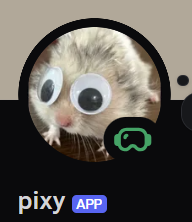

# discord-vr-status

Give your Discord bot the **VR status**: the VR headset icon on its profile, the one Discord shows for
people using the Meta Quest app.



Works with [discord.py](https://github.com/Rapptz/discord.py) 2.x. One small file, no extra dependencies.

> Unofficial. Discord doesn't document this and could stop it from working at any time.

⭐ If this helped your bot, consider giving the repo a star!

## How to give your bot the VR status

1. Copy [`vr_status.py`](vr_status.py) next to your bot's code.
2. Call `show_vr_status()` **before** `bot.run(...)`:

   ```python
   from vr_status import show_vr_status

   show_vr_status()
   bot.run(TOKEN)
   ```

3. Fully stop the bot and start it again.
4. Open the bot's profile in Discord: the status dot is now a VR headset.

[`example.py`](example.py) is a complete minimal bot.

## How it works

When a bot connects, it tells Discord which app it is, with three values: `os`, `browser` and `device`.
Discord picks the profile icon from them. These values give the VR headset:

| `os` | `browser` | `device` |
| --- | --- | --- |
| `android` | `Discord VR` | `Discord VR` |

`vr_status.py` changes only those three values in the bot's first message to Discord, and makes sure the
bot connects as online. It uses your normal bot token and changes nothing else.

## If the VR headset doesn't show

- **The bot must be online.** Discord only shows the headset for online accounts. Idle shows the moon,
  do-not-disturb the red dot. If your code calls `change_presence(status=discord.Status.idle)` or `dnd`,
  change it to `discord.Status.online`. Activities like "Watching ..." are fine.
- **Restart fully.** The values are only sent on the first connection, not when the bot reconnects.
- **Call `show_vr_status()` before `bot.run()`.** After that, the bot has already connected.
- **Give it a minute.** Discord can keep showing the old icon briefly; reopening the profile helps.
- **Values are case-sensitive:** `android`, `Discord VR`. A typo doesn't cause an error, the bot just
  shows the normal dot.

The bot can't check this itself, because Discord doesn't send a bot its own presence. Look at its profile.

## Other languages and libraries

`vr_status.py` is for discord.py, but the VR status isn't tied to Python. It works the same way with any
language or library, such as JavaScript (discord.js, Eris), Java (JDA), C# (Discord.Net), Go (discordgo) or
Rust (serenity), because it's just what the bot tells Discord when it connects.

When a bot connects, it sends Discord an identify message (opcode `2`). Find where your library builds it
and make it send these values, with the status online:

```json
{
  "op": 2,
  "d": {
    "properties": {
      "os": "android",
      "browser": "Discord VR",
      "device": "Discord VR"
    },
    "presence": { "status": "online" }
  }
}
```

Many libraries let you set these `properties` as a client option. Otherwise you can change them where the
library sends the identify message, like `vr_status.py` does for discord.py. The same rules apply: the
status must be online, and the bot needs a full restart.
